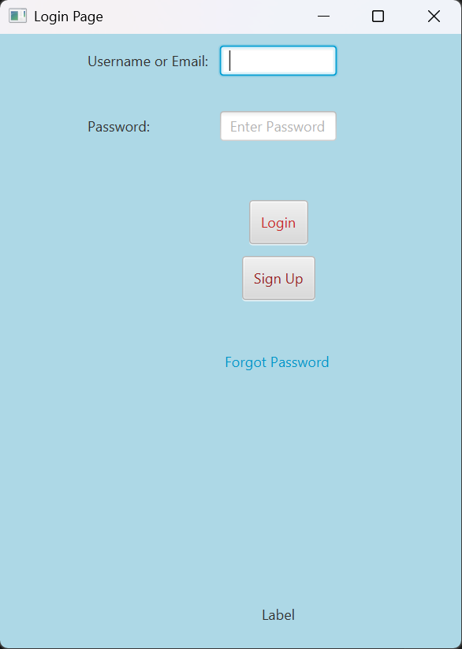
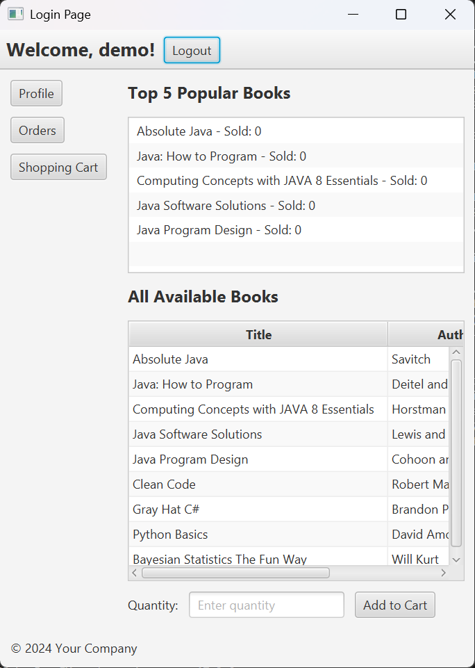
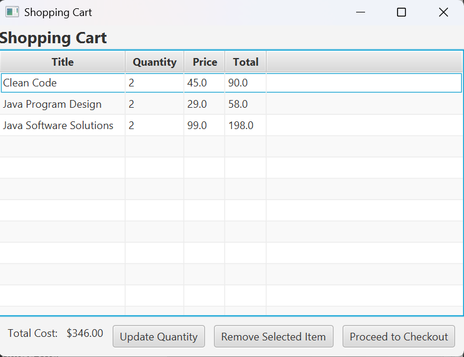
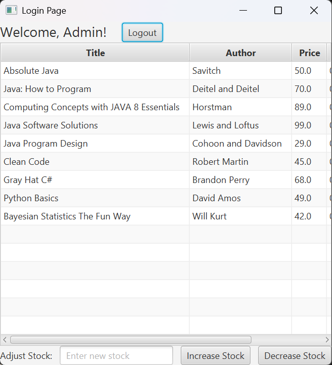

# The Reading Room – JavaFX Bookstore

A desktop bookstore application built in **Java** and **JavaFX**. Users can sign up, browse books, manage a shopping cart, check out and view their order history. Admins manage stock from their own dashboard.

| Login | Store |
|---|---|
|  |  |
| **Shopping cart** | **Admin dashboard** |
|  |  |

## Features

- **Accounts:** sign up, log in with username or email, forgot/reset password and profile editing
- **Secure passwords:** stored as salted PBKDF2 (HMAC-SHA256) hashes, never as plain text
- **Bookstore:** browse books with live stock levels
- **Shopping cart:** stock checks and warnings, quantity updates, saved between sessions
- **Checkout:** validated card number, expiry date and CVV
- **Order history:** newest first, with CSV export of selected orders
- **Admin dashboard:** update book stock

## Architecture

The app follows **MVC**:

```
demo/src/main/java
├── model/        Business logic and data access (User, Book, ShoppingCart, Order, Database,
│                 PasswordHasher, PaymentValidator)
├── controller/   JavaFX controllers, one per screen
└── view/         App start-up
demo/src/main/resources/view   FXML layouts for each screen
```

- **Singleton** pattern for the logged-in `User` and the `ShoppingCart`
- **JDBC + SQLite** for persistence, with `PreparedStatement` for every query that takes user input (protects against SQL injection)
- Validation rules live in model classes so they can be unit tested without the UI

## Tech stack

Java 17, JavaFX 17, SQLite (JDBC), Maven, JUnit 5

## Run it

Requires JDK 17 or newer.

```bash
cd demo
./mvnw clean javafx:run      # on Windows: mvnw.cmd clean javafx:run
```

The SQLite database is created automatically in `demo/databases/` on first run and seeded with sample books. It is not committed to the repository.

Demo admin login (local use only): `admin` / `reading_admin`

## Tests

```bash
cd demo
./mvnw test
```

JUnit 5 tests cover:

- **Password hashing:** hashes are salted, verify correctly and reject wrong or plain-text values
- **Payment validation:** card number, CVV and expiry rules, including expired cards
- **Shopping cart:** totals, merging quantities, stock limits and removing items
- **Books:** selling and restocking stock
- **Users:** sign-up, login, admin login, email validation and checking that passwords are stored hashed

## Author

Nithyashree KP, Master of Information Technology, RMIT University
[LinkedIn](https://www.linkedin.com/in/nithukp) · [GitHub](https://github.com/nithyash2)
